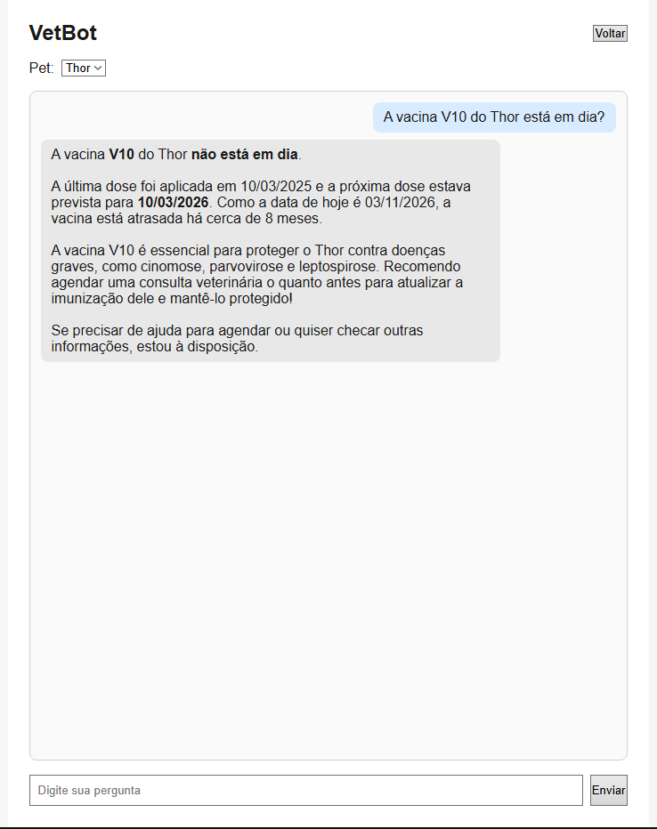

# LifePet - VetBot API (Sprint 4)

Disruptive Architectures: IoT, IoB & Generative IA - Challenge FIAP 2026
Empresa parceira: Clyvo VET

Vídeo de demonstração (YouTube, não listado): LINK_DO_VIDEO

## Sobre a Sprint 4

Na Sprint 3, o VetBot foi desenvolvido em um notebook do Google Colab. Na Sprint 4, a solução de IA saiu do notebook e virou uma API REST independente (FastAPI), que pode ser ligada a qualquer aplicação (Java, .NET, mobile, web).

Para demonstrar a integração, a API foi conectada ao back-end Java (Spring Boot) e ao front-end React do LifePet, desenvolvidos na disciplina de Java Advanced. O tutor conversa com o VetBot dentro do próprio aplicativo: o Java busca os dados reais do pet no banco, envia à API de IA junto com a pergunta, e a resposta volta ao tutor personalizada pelo histórico do animal.



## Benefícios

Para o tutor:
- Consulta o histórico do pet em linguagem natural, sem navegar por telas.
- Recebe orientação preventiva personalizada por espécie, raça, idade e histórico.
- É avisado quando uma vacina está atrasada e quando há sinal de alerta que exige consulta.

Para a clínica:
- Estimula o retorno preventivo (vacinas, check-ups), aumentando a recorrência.
- O mesmo serviço de IA pode ser conectado a outras aplicações da clínica.

## Arquitetura

```
Tutor (navegador)
      |
Front-end React (porta 5173)
      |  POST /chat (JWT)
Back-end Java Spring Boot (porta 8080)
      |  busca o pet no banco (H2) e chama a API de IA
      |  POST /chat (pergunta + dados do pet)
API de IA - FastAPI (porta 8000)
      |
VetBot (Gemini)
   |-- RAG: 8 documentos veterinários, busca por similaridade semântica
   |-- Function Calling: 4 ferramentas sobre os dados do pet
   |-- Interactions API: histórico da conversa (conversaId)
```

Fluxo de uma pergunta:

1. O tutor escolhe o pet e envia a pergunta no front-end.
2. O front-end chama o Java (`POST /chat`) com o token JWT.
3. O Java busca o pet completo (vacinas, consultas, medicamentos, histórico) e envia à API de IA.
4. A API de IA recupera os documentos mais relevantes (RAG), deixa o Gemini consultar os dados do pet por Function Calling e gera a resposta.
5. O Java devolve a resposta e o `conversaId`, que o front-end reenvia na pergunta seguinte para manter o contexto.

## Tecnologias

- Python 3.14, FastAPI, Uvicorn, Pydantic
- Gemini 3.5 Flash (modelo de linguagem) e gemini-embedding-001 (embeddings), SDK google-genai
- NumPy (similaridade por cosseno no RAG)
- Java 17+, Spring Boot 3.3.5, Spring Security com JWT, JPA, Flyway, H2
- React com TypeScript e Vite

## Estrutura do repositório

```
LifePet-VetBot-API/
├── main.py              API FastAPI (rotas GET / e POST /chat)
├── schemas.py           contrato de entrada e saída (pet, pergunta, resposta)
├── vetbot.py            lógica do assistente: RAG, ferramentas e histórico
├── rag.py               embeddings e busca por similaridade
├── ferramentas.py       Function Calling (4 ferramentas)
├── documentos.py        base de conhecimento veterinária (8 documentos)
├── config.py            chave da API e modelos
├── requirements.txt     dependências Python
├── .env.example         modelo do arquivo .env
├── docs/                imagens usadas neste README
├── README.md
└── integracao/
    ├── java/            classes adicionadas ao back-end Java do LifePet
    └── frontend/        página de chat adicionada ao front-end React
```

## Contrato da API de IA

`POST /chat`

```json
{
  "pergunta": "A vacina do Thor está em dia?",
  "pet": {
    "nome": "Thor", "idade": 3, "raca": "Golden Retriever",
    "especie": "cachorro", "peso": 28.5,
    "vacinas": [{"nome": "V10", "dataAplicacao": "2025-03-10", "proximaDose": "2026-03-10"}],
    "consultas": [], "medicamentos": [], "historicos": []
  },
  "conversaId": null
}
```

Resposta:

```json
{ "resposta": "texto do VetBot", "conversaId": "id para continuar a conversa" }
```

Os nomes dos campos de `pet` seguem as entidades do projeto Java, de modo que o Java envia o objeto sem conversão. A documentação interativa fica em `http://127.0.0.1:8000/docs`.

## Como executar

### 1. API de IA (Python)

Crie o arquivo `.env` na raiz, copiando o `.env.example`, e informe sua chave do Google AI Studio (aistudio.google.com/apikey):

```
GEMINI_API_KEY=sua_chave_aqui
```

No terminal, na raiz do projeto:

```
python -m venv .venv
.venv\Scripts\Activate.ps1
pip install -r requirements.txt
python -m uvicorn main:app --reload
```

A API fica em `http://127.0.0.1:8000`. O arquivo `.env` está no `.gitignore` e não deve ser enviado ao GitHub.

### 2. Back-end Java

A integração foi feita sobre o projeto Java do LifePet (Sprint 3 de Java Advanced). Os arquivos estão em `integracao/java/`:

- `ChatController.java`, `ChatRequestDTO.java` e `ChatResponseDTO.java`: rota `POST /chat`, protegida por JWT.
- `ChatService.java`: busca o pet no banco e chama a API de IA com `RestClient`.
- `DadosTesteInitializer.java`: cria um tutor e o pet de teste Thor (id 1), com vacinas e medicamento.

Copie `ChatController` para o pacote `controller`, `ChatService` para `service`, os DTOs para `dto` e o inicializador para `config`. No `application.properties`, adicione:

```
vetbot.api.url=http://127.0.0.1:8000
```

Execute `LifepetApplication`. O Java sobe na porta 8080. Usuário de teste: `vitor@email.com`, senha `123456`.

### 3. Front-end React

Copie `integracao/frontend/Chat.tsx` para `src/pages/` do front-end e registre a rota `/chat` no `App.tsx` (import de `Chat` e uma `Route` protegida por token). Depois:

```
npm install
npm run dev
```

Acesse `http://localhost:5173`, entre com o usuário de teste e abra `http://localhost:5173/chat`.

## Testes realizados

- API de IA: rotas `GET /` e `POST /chat` testadas pelo Swagger (`/docs`), com resposta 200.
- RAG: a pergunta sobre um cachorro vomitando e sem energia recuperou o documento de sinais de alerta em primeiro lugar.
- Function Calling: ferramentas testadas isoladamente, incluindo o caso de pet não encontrado. Nos testes com o Gemini, o modelo encadeou mais de uma chamada de ferramenta antes de responder, e o assistente trata isso em um laço de até 5 rodadas.
- Integração: login no Java (`POST /auth/login`) e chamada `POST /chat` com o token, com a resposta do VetBot baseada nos dados do banco.
- Interface: conversa completa pela tela de chat. A pergunta sobre a vacina V10 do Thor retornou que ela está atrasada (próxima dose em 10/03/2026), com recomendação de consulta.
- Histórico: a pergunta seguinte ("Sobre qual vacina eu perguntei antes?") foi respondida corretamente usando o `conversaId`.

## Resultados parciais

- A IA deixou de depender de um notebook e passou a ser um serviço reutilizável por HTTP.
- As respostas usam dados reais do pet vindos do banco do aplicativo, e não uma lista fixa.
- Personalização por espécie, raça, idade e histórico clínico, com a data atual para identificar vacinas atrasadas.
- O VetBot não faz diagnóstico definitivo e recomenda consulta veterinária quando há sinal de atenção.

## Limitações conhecidas

- O banco do Java (H2) é em memória: os dados de teste são recriados a cada execução.
- O modelo `gemini-3.5-flash` pode retornar erro 503 em momentos de alta demanda. Nesse caso, a API devolve erro 502 e basta repetir a pergunta.
- Os dados do pet são enviados inteiros a cada pergunta, o que é adequado ao tamanho atual do histórico.
- O token JWT do Java expira em cerca de uma hora; após isso é preciso entrar de novo.

## Repositórios relacionados

- Sprints 1 e 2 (IoT): https://github.com/Leonardo-Saavedra/LifePet-GS
- Sprint 3 (VetBot no Colab): https://github.com/Leonardo-Saavedra/LifePet-IA-3-sprint

## Equipe da LifePet

Aguinel Junior - RM564857

Felipe Garcia - RM563485

Henrique Gonçalves - RM562086

Leonardo Saavedra - RM562229

Vitor Mendes - RM565376
